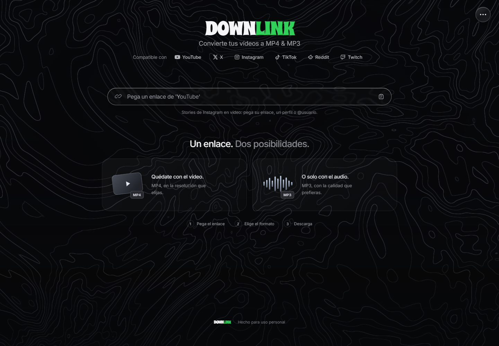
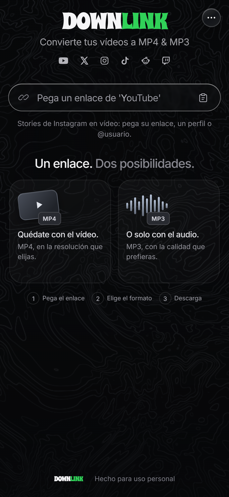

# Downlink

Descarga vídeos como MP4 o extrae su audio como MP3 desde enlaces compatibles de YouTube, X, Instagram, TikTok, Reddit y Twitch.

El repositorio contiene una web autoalojada, una PWA instalable, una aplicación Android autónoma y un proyecto nativo iOS. La interfaz está actualmente en español. El funcionamiento de cada enlace depende de la disponibilidad del contenido, los permisos de la cuenta y los extractores de terceros.

[English](README.md) · [Colaborar](CONTRIBUTING.md) · [Seguridad](SECURITY.md) · [Validación](docs/VALIDATION.md)

## Elige una versión

| Versión | Dónde se descarga y convierte | Requisitos y validación | Guía |
| --- | --- | --- | --- |
| **Web** | En el ordenador o servidor, con Node.js, yt-dlp y FFmpeg | Navegador; Node.js 22 probado en Windows. Pruebas automatizadas y arranque comprobados. | [Inicio rápido](#inicio-rápido-web) |
| **PWA para iPhone/iPad** | En el mismo servidor Node de la web | Instalación desde Safari; HTTPS de confianza para el service worker. El servidor debe permanecer activo. La automatización no valida un iPhone físico. | [Instalación PWA](ios-embedded/README.md) |
| **Android** | En el teléfono, con Python, yt-dlp, QuickJS y FFmpeg incluidos | Android 10+; ARM64 para teléfono y x86_64 para emulador. Hay informes históricos; esta auditoría no pudo compilar por falta de SDK. | [Compilación y pruebas](android/README.md) |
| **iOS nativa** | En el dispositivo, con SwiftUI, CPython integrado, WebKit y FFmpeg | Objetivo iOS 17+; requiere macOS y Xcode. Se probó el motor Python; la compilación Swift y el dispositivo quedan sin verificar en esta auditoría. | [Preparación y firma](ios/README.md) |

La PWA y la aplicación nativa iOS son implementaciones diferentes. La PWA no incorpora el motor de descarga en el teléfono. En la [auditoría del 26 de octubre de 2026](docs/AUDIT.md) no se encontraron releases etiquetadas; las rutas de APK de informes anteriores corresponden a archivos generados localmente.

## Funciones presentes en el código

- Reconocimiento de enlaces compatibles, metadatos y selección de resolución de vídeo o bitrate MP3.
- Preparación de MP4 o MP3, progreso y cancelación.
- Selección de vídeos en carruseles y stories de Instagram, incluidos perfiles, destacados y entradas `@usuario`.
- Conexión opcional a Instagram, con mecanismos de inicio de sesión y almacenamiento distintos en cada plataforma.
- Recuperación de trabajos web/PWA al reabrir, mientras sigan disponibles en el servidor.
- En Android, recepción de enlaces compartidos, cola y guardado mediante MediaStore en `Download/Downlink`.

El [informe de validación](docs/VALIDATION.md) distingue las pruebas automatizadas de las comprobaciones reales. Los datos simulados no garantizan compatibilidad actual con cada servicio. Las fotografías no se convierten en vídeo; no se recuperan stories caducadas o inaccesibles. Convertir a MP3 no añade audio ni mejora la calidad original.

## Capturas

Interfaz real capturada por la prueba de navegador existente el 26 de octubre de 2026, sin cuentas personales ni contenido descargado. La imagen móvil utiliza emulación de pantalla de iPhone en Chrome; no representa una aplicación nativa.

| Web de escritorio | Diseño móvil web/PWA |
| --- | --- |
|  |  |

[Procedencia y reproducción](docs/screenshots/README.md). No se han aportado capturas de las aplicaciones nativas.

## Inicio rápido web

Necesitas Git, npm, Node.js 22 (familia comprobada), acceso a Internet para las dependencias y el extractor, y espacio local con permisos de escritura.

```sh
git clone https://github.com/maicolois/Downlink.git
cd Downlink
npm ci
npm start
```

Abre **http://localhost:3000**. Para desarrollo con recarga automática del servidor, ejecuta `npm run dev`.

`npm ci` utiliza el lockfile e instala los paquetes de FFmpeg/FFprobe, incluidos sus binarios. Al arrancar, el servidor reutiliza `bin/yt-dlp*` o descarga el ejecutable apropiado desde la última release de yt-dlp. En Unix, el extractor genérico puede necesitar Python 3. Esta descarga automática no está fijada como las dependencias de las versiones nativas.

| Variable | Uso |
| --- | --- |
| `PORT` | Puerto HTTP; valor predeterminado `3000`. |
| `HOST` | Dirección de escucha; `127.0.0.1` por defecto (solo este ordenador). Configúrala expresamente para acceso desde la red local/PWA. |
| `YT_DLP_PATH` | Ruta opcional a un ejecutable de yt-dlp administrado por ti. |
| `CHROME_PATH` | Ejecutable alternativo de Chrome/Chromium para las pruebas de navegador. |

El script de arranque no carga automáticamente un archivo `.env`. Configura las variables en la terminal o en el servicio. Ejemplo en PowerShell:

```powershell
$env:PORT = '3000'
npm start
```

El servidor escucha en **127.0.0.1 por defecto**. Para utilizar la PWA desde otro dispositivo de tu red local, configura `HOST` con la IP local del ordenador o, expresamente, con `0.0.0.0` (todas las interfaces IPv4). Por ejemplo, en PowerShell:

```powershell
$env:HOST = '0.0.0.0'
npm start
```

Abre `http://IP-LOCAL-DEL-ORDENADOR:3000` desde el otro dispositivo. Para recuperar el valor predeterminado, detén el servidor, ejecuta `Remove-Item Env:HOST` y vuelve a arrancarlo. Un proxy inverso o Tailscale Serve en el mismo ordenador puede mantener la escucha local; consulta la [guía PWA](ios-embedded/README.md). Un despliegue público sigue necesitando controles de acceso y límites de consumo. La auditoría npm del lockfile actualizado no detecta avisos en la fecha de la [revisión](docs/AUDIT.md#dependency-review).

## Instagram y funcionamiento web/PWA

Para vídeos de YouTube que necesitan una cuenta autorizada, abre Downlink en Chrome y pulsa **⋯ → Sesión de YouTube → Conectar YouTube**. La cuenta debe poder reproducir el contenido en YouTube.

Si YouTube solicita una cuenta al analizar o preparar la descarga, también puedes pulsar **Conectar sesión de YouTube** junto al mensaje. Al activar la sesión, Downlink vuelve a analizar el enlace automáticamente; después elige de nuevo la calidad e inicia la descarga.

Chrome protege sus cookies con App-Bound Encryption, por lo que necesita el [puente local de YouTube](browser-extension/youtube-bridge/README.md). Instálalo una vez desde `chrome://extensions` mediante **Cargar descomprimida** y abre Downlink en Chrome. Al pulsar **Conectar YouTube**, el puente utiliza la sesión existente o abre una ventana normal para iniciar sesión y la cierra al detectar la conexión. La extensión entrega solo las cookies de `youtube.com` mediante un token de un solo uso. Downlink las conserva en memoria y crea un archivo temporal aislado únicamente mientras `yt-dlp` trabaja; después lo elimina. La contraseña nunca sale de Chrome.

YouTube también necesita actualmente un runtime JavaScript. Downlink detecta Deno cuando se instala mediante Winget; se puede indicar otra ubicación con `DENO_PATH`. Si no encuentra Deno, utiliza Node.js 22 o posterior, que ya ejecuta el servidor.

Para conectar Instagram en el ordenador, instala el [puente de Chrome/Edge](browser-extension/instagram-bridge/README.md), abre Downlink en `localhost` y utiliza **⋯ → Conectar Instagram**. El inicio de sesión se realiza en Instagram. El servidor comprueba el origen y la conexión local real; no es un inicio de sesión remoto para la PWA.

La conexión web dura hasta ocho horas y termina al reiniciar el servidor. Desconectar cancela las descargas privadas pendientes y elimina sus archivos del servidor. No se aplica un `INSTAGRAM_COOKIES_FILE` compartido a todos los visitantes.

Los trabajos y archivos web/PWA son temporales, con recuperación de hasta cuatro horas. El service worker almacena la interfaz pública, no medios, respuestas de API ni sesiones. Abrir la interfaz sin conexión no permite extraer ni convertir contenido.

Se conservan las instrucciones originales de stories, aislamiento, limpieza y alias en la [guía técnica web](docs/web-guide.es.md). Sigue las guías de [Android](android/README.md) e [iOS nativa](ios/README.md) para sus diferencias de sesión y almacenamiento.

## Pruebas

Desde la raíz, después de `npm ci`:

```sh
npm test
npm run test:ios
node node_modules/playwright-core/cli.js install webkit
npm run test:ios-embedded
```

- `npm test`: pruebas Node y API con extractores simulados, incluidas las sesiones de descarga PWA.
- `npm run test:ios`: motor Python; no compila Xcode. Requiere Python 3; dos pruebas se omiten si falta yt-dlp. Para ejecutar las diez, instala la versión del bootstrap en un entorno Python aislado: `python -m pip install yt-dlp==2026.8.19`. En Windows el script prefiere `py -3`; ese intérprete debe poder importar el paquete.
- `npm run test:ios-embedded`: interfaz y service worker reales con API sintética. Requiere Google Chrome o `CHROME_PATH` y WebKit de Playwright. No descarga de plataformas externas.

Los comandos específicos de Android e iOS están en sus guías. Consulta los [resultados fechados](docs/VALIDATION.md), incluido el fallo anterior del navegador y el ajuste de sincronización de la prueba. [GitHub Actions](.github/workflows/ci.yml) está configurado para pruebas Node, Python, navegador y auditoría npm. La [guía de CI](docs/CI_PROPOSAL.md) explica su alcance; todavía no se ha verificado una ejecución remota.

## Estructura y colaboración

`public/` contiene la interfaz; `server/`, API y conversión; `shared/`, patrones y configuración compartida. Las carpetas `android/`, `ios/` e `ios-embedded/` mantienen sus implementaciones y pruebas. El puente local está en `browser-extension/instagram-bridge/`; las pruebas Node, en `tests/`; los informes y propuestas, en `docs/`.

Usa los comandos npm para registrar el alias `@/`. La web utiliza el import map de `public/index.html` y el editor, `jsconfig.json`.

`bin/`, `downloads/`, `node_modules/`, `artifacts/`, las claves de firma y la configuración local están excluidos de Git. No incluyas descargas ni datos de cuenta en commits o archivos de distribución.

Consulta [CONTRIBUTING.md](CONTRIBUTING.md) para colaborar y [SECURITY.md](SECURITY.md) para comunicar vulnerabilidades. La [auditoría](docs/AUDIT.md) incluye cambios completados, prioridades, descripción y topics; el [plan de primera prerelease](docs/RELEASE_PLAN.md) no publica ninguna release.

## Estado de la licencia

El código propio de Downlink está publicado bajo **GPL-3.0-only**; consulta [LICENSE](LICENSE). El código, los binarios y los recursos de terceros conservan sus respectivas licencias y avisos. La licencia raíz no cambia las licencias de esos componentes.

Se conservan la [licencia de Android](android/LICENSE) y sus [avisos de componentes](android/THIRD_PARTY.md). iOS nativa utiliza FFmpeg con GPL; consulta [sus notas](ios/README.md#licencias). Antes de distribuir binarios sigue siendo necesario revisar las licencias y las obligaciones de entrega del código fuente de los componentes concretos incluidos.

Descarga únicamente contenido propio o autorizado, respetando los derechos de autor y las condiciones de cada servicio.
