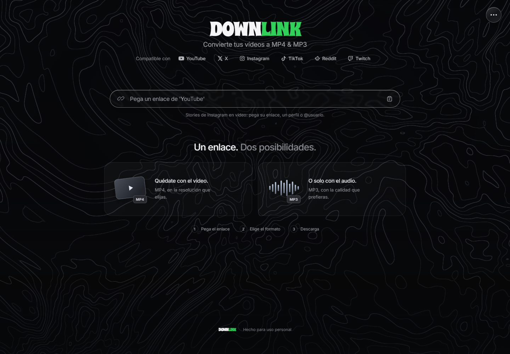
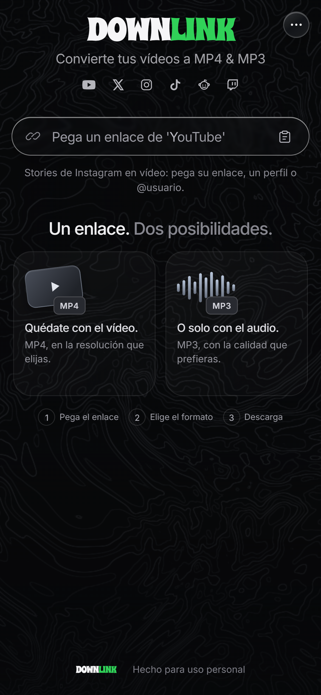

# Downlink

Download video as MP4 or extract audio as MP3 from supported YouTube, X, Instagram, TikTok, Reddit and Twitch links.

Downlink includes a self-hosted web app, an installable web app (PWA), a standalone Android app and a native iOS project. The interface is currently in Spanish. Site availability, account permissions and upstream extractors determine whether an individual link works.

[Español](README.es.md) · [Contributing](CONTRIBUTING.md) · [Security](SECURITY.md) · [Validation report](docs/VALIDATION.md)

## Choose a version

| Version | Where extraction and conversion run | Requirements and status | Guide |
| --- | --- | --- | --- |
| **Web** | Your computer or server, using Node.js, yt-dlp and FFmpeg | Browser UI; Node.js 22 tested on Windows. Automated tests and startup checked. | [Quick start](#web-quick-start) |
| **iPhone/iPad PWA** | The same Node server as the web app | Install from Safari; trusted HTTPS for the service worker. The server must stay running. Browser automation does not verify a physical iPhone. | [PWA setup](ios-embedded/README.md) |
| **Android** | On the phone, using bundled Python, yt-dlp, QuickJS and FFmpeg | Android 10+; ARM64 phone and x86_64 emulator builds. Historical emulator reports exist; this audit could not build without an Android SDK. | [Build, install and test](android/README.md) |
| **Native iOS** | On the device, through SwiftUI, embedded CPython, WebKit and FFmpeg | iOS 17+ target; macOS and Xcode required. Python engine tested here; Swift compilation and device behavior remain unverified in this audit. | [Mac setup and signing](ios/README.md) |

The PWA and native iOS project are separate implementations. Installing the PWA does not bundle the download engine on the phone. There are no tagged releases in the repository as of the [2026-10-26 audit](docs/AUDIT.md); generated APK paths in older reports are local build outputs.

## What the code supports

- Recognize supported links, load metadata and select the available video resolution or MP3 bitrate.
- Prepare MP4 video or MP3 audio, with progress and cancellation.
- Select video items from Instagram carousels and stories, including profile, highlight and `@username` inputs.
- Optionally connect an Instagram session, with different platform-specific login and storage mechanisms.
- Recover a web/PWA job after reopening while it remains available on the server.
- On Android, receive shared links, queue downloads and save files through MediaStore to `Download/Downlink`.

These capabilities are backed by code and the tests described in the [validation report](docs/VALIDATION.md). Automated fixtures do not establish current live-site compatibility. Photos are not converted into videos; inaccessible or expired stories cannot be recovered. MP3 conversion cannot restore missing audio or improve the source's original quality.

## Screenshots

Actual production UI captured by the existing browser test on 2026-10-26, without personal accounts or downloaded content. The mobile image uses Chrome's iPhone viewport emulation; it is not a native iOS or Android screenshot.

| Desktop web | Mobile web / PWA layout |
| --- | --- |
|  |  |

[Capture provenance and reproduction](docs/screenshots/README.md). Native app screenshots have not been supplied.

## Web quick start

Requirements: Git, npm and Node.js 22 (the tested runtime family), Internet access to install packages and obtain the extractor, and writable local storage for temporary media.

```sh
git clone https://github.com/maicolois/Downlink.git
cd Downlink
npm ci
npm start
```

Open **http://localhost:3000**. For development with automatic server reloads, use `npm run dev`.

`npm ci` uses the committed lockfile and installs the FFmpeg/FFprobe packages, including native binaries. At startup, the server reuses `bin/yt-dlp*` or downloads the appropriate yt-dlp executable from its upstream latest release. On Unix, the generic extractor may also require Python 3. This automatic extractor download is not pinned like the native platform builds.

| Setting | Purpose |
| --- | --- |
| `PORT` | HTTP port; defaults to `3000`. |
| `HOST` | Bind address; defaults to `127.0.0.1` (this computer only). Set explicitly for LAN/PWA access. |
| `YT_DLP_PATH` | Optional path to an existing managed yt-dlp executable. |
| `CHROME_PATH` | Optional Chrome/Chromium executable for the browser test. |

There is no automatic `.env` loader in the start script; set environment variables in your shell or service configuration. For example, in PowerShell:

```powershell
$env:PORT = '3000'
npm start
```

The server listens on **127.0.0.1 by default**. To use the PWA from another device on a trusted local network, set `HOST` to your computer's LAN IP or explicitly to `0.0.0.0` (all IPv4 interfaces) before starting. For example, in PowerShell:

```powershell
$env:HOST = '0.0.0.0'
npm start
```

Open `http://YOUR-COMPUTER-LAN-IP:3000` on the other device. Stop the server and remove the setting with `Remove-Item Env:HOST` to restore the local-only default. A reverse proxy or Tailscale Serve on the same computer can keep the default bind address; see the [PWA guide](ios-embedded/README.md). Public hosting still needs access controls and resource limits. The updated npm lockfile has no advisories reported by the dated [dependency audit](docs/AUDIT.md#dependency-review).

## Instagram and web/PWA behavior

For local desktop login, install the [Chrome/Edge Instagram bridge](browser-extension/instagram-bridge/README.md), open Downlink on `localhost`, and choose **⋯ → Conectar Instagram**. Login happens on Instagram. The server checks the actual local connection and origin; this is not a remote sign-in flow for a hosted PWA.

The web connection lasts up to eight hours and ends when the server restarts. Disconnecting cancels its unfinished private downloads and removes associated server files. The web server does not apply a shared `INSTAGRAM_COOKIES_FILE` to every visitor.

Web/PWA jobs and files are temporary, with a recovery window of up to four hours. The service worker caches the public interface, not media, API responses or account sessions. Offline access to the shell does not provide offline extraction or conversion.

The original detailed instructions for stories, session isolation, cleanup and import aliases are preserved in the [Spanish web technical guide](docs/web-guide.es.md). Follow the separate [Android](android/README.md) and [native iOS](ios/README.md) guides for their login and storage behavior.

## Run the tests

From the repository root after `npm ci`:

```sh
npm test
npm run test:ios
node node_modules/playwright-core/cli.js install webkit
npm run test:ios-embedded
```

- `npm test`: Node unit and fixture-backed API tests, including PWA download-session tests.
- `npm run test:ios`: Python engine tests, not an Xcode build. Requires Python 3; without yt-dlp, two tests skip. For the complete suite, install the version used by the native bootstrap in an isolated Python environment: `python -m pip install yt-dlp==2026.8.19`. On Windows the runner prefers `py -3`, so ensure that interpreter can import the package.
- `npm run test:ios-embedded`: actual UI/service worker with a synthetic API. Requires Google Chrome or `CHROME_PATH`, plus Playwright WebKit. It does not download from third-party platforms.

For Android unit/lint/emulator commands and iOS build verification, use the platform guides. See [dated outcomes and limitations](docs/VALIDATION.md), including the earlier browser failure and the test synchronization change. [GitHub Actions](.github/workflows/ci.yml) is configured for Node, Python, browser and npm audit checks. The [CI guide](docs/CI_PROPOSAL.md) explains its scope; no remote run has been verified yet.

## Repository layout

```text
public/                         Shared browser interface, styles and assets
server/                         Express API, auth, providers and conversion services
shared/                         Link patterns, quality definitions and selection helpers
ios-embedded/                   PWA assets, service worker and browser tests
android/                        Native Android app, tests and third-party notices
ios/                            Native SwiftUI project, Python engine and bootstrap scripts
browser-extension/instagram-bridge/  Local desktop Instagram session bridge
tests/                          Node tests and synthetic extractor fixtures
scripts/                        Node alias loader and Android build/test tooling
docs/                           Audit, validation, screenshots and maintainer proposals
```

Use the npm commands: internal JavaScript imports use the `@/` root alias registered by these scripts. The browser uses the import map in `public/index.html`; editor resolution is in `jsconfig.json`. The older wave background remains in `public/js/backgrounds/wave-background.js`.

`bin/`, `downloads/`, `node_modules/`, `artifacts/`, signing keys and local configuration are ignored by Git. Keep local downloads and account material out of commits and source archives.

## Contributing and security

Small, focused contributions with reproducible examples are welcome. Start with [CONTRIBUTING.md](CONTRIBUTING.md); report vulnerabilities using [SECURITY.md](SECURITY.md).

The [maintainer audit](docs/AUDIT.md) contains completed changes, prioritized follow-up work and a suggested GitHub description/topics. A [first prerelease plan](docs/RELEASE_PLAN.md) records verified scope and outstanding checks; no release has been created.

## Licensing status

First-party Downlink code is licensed under **GPL-3.0-only**; see [LICENSE](LICENSE). Existing third-party code, binaries and assets retain their respective licenses and notices. The root license does not relicense those components.

Android's existing [license](android/LICENSE) and [component notices](android/THIRD_PARTY.md) are retained. Native iOS uses GPL-licensed FFmpeg dependencies; see [its licensing notes](ios/README.md#licencias). Binary distribution still requires reviewing the licenses and corresponding-source obligations of the exact bundled components.

Download only content you own or are authorized to download, respecting copyright and each service's terms.
